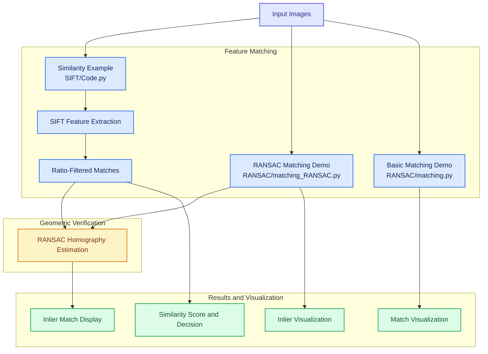

# Computer Vision 
### Similarity match

## Image Similarity and Feature Matching using OpenCV

This project demonstrates image similarity analysis using **SIFT feature extraction, descriptor matching, ratio filtering, and RANSAC-based homography estimation**. It visualizes feature correspondences and geometrically consistent matches, then calculates a similarity score to classify two images.

### Workflow Diagram

### Main Techniques

- **SIFT:** Detects distinctive keypoints and computes feature descriptors.
- **Brute-Force Matching:** Matches descriptors between the two images.
- **Ratio Test:** Filters ambiguous matches using the nearest and second-nearest descriptor distances.
- **RANSAC Homography:** Estimates a geometric transformation while rejecting inconsistent correspondences.
- **Match Visualization:** Displays corresponding keypoints between images.
- **Similarity Classification:** Calculates a similarity score and compares it against a predefined threshold.

### Implementation Note

The provided code estimates a homography but does not apply it to create a warped image using `cv2.warpPerspective()`. The diagram therefore focuses on the implemented matching, verification, and visualization workflow.

The similarity score is a heuristic based on the number of ratio-filtered matches relative to the smaller keypoint count; it is not a universal measure of image similarity.

